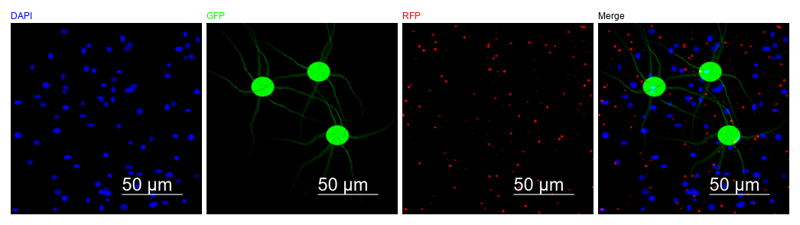
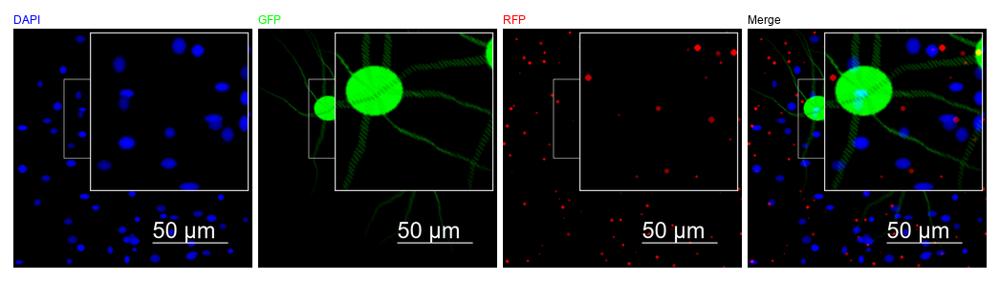

# FluoFigFactory

**多通道荧光显微图像排版与发表级导出工具** —— 免费开源的 Channel Scope Studio 替代方案

[](https://www.python.org/)
[](https://flask.palletsprojects.com/)
[](LICENSE)
[](#)



> 上图为工具直接导出的排版图（4 面板：DAPI / GFP / RFP / Merge，含 50 μm 标尺）。

---

## 目录

- [为什么有这个项目](#为什么有这个项目)
- [功能特性](#功能特性)
- [快速开始](#快速开始)
- [使用流程](#使用流程)
- [导出规格](#导出规格)
- [项目结构](#项目结构)
- [开发与测试](#开发与测试)
- [打包为单文件 exe](#打包为单文件-exe)
- [常见问题](#常见问题)
- [已知限制](#已知限制)
- [许可证](#许可证)

## 为什么有这个项目

[Channel Scope Studio] 是一款好用的荧光图排版软件，但它是 Microsoft Store 的 UWP 应用，在部分系统/地区无法安装。同时，科研制图中常需要在 Illustrator / Inkscape 里继续微调 ROI 框、标尺和通道标签，而普通拼图工具只能导出扁平位图。

FluoFigFactory 用「本地 Flask 服务 + 浏览器界面」实现同样的工作流，并且：

- **完全本地运行** —— 图像不上传云端，适合未发表数据
- **矢量导出** —— SVG / PDF 中底图、ROI、标尺、Inset、标签各自独立，可分层编辑
- **针对 Olympus FV3000 优化** —— 自动识别放大倍数/Zoom，按视场公式换算物理比例尺
- **可打包成单个 exe** —— 双击即用，无需安装 Python

## 功能特性

### 图像导入

- TIFF / TIF，单页或多页；支持 LZW、deflate、JPEG、zstd 等压缩方式
- 单文件、多文件、整个文件夹三种导入方式
- 自动读取 FV3000 元数据（放大倍数、Zoom、物镜信息）
- 从文件名识别通道（如 `sample_488_GFP.tif`、`slice1_594.tif`），并可一键应用识别结果
- 自动剔除空通道（可按需恢复）
- RGB 合成图自动拆分为 R / G / B 三个平面

### 通道管理

- 通道命名、伪彩颜色、亮度 / 对比度 / 黑场 / 白场 / Gamma
- 通道可见性开关、拖拽排序
- 随时切换通道数量（1–4）

### 排版

- 单通道、通道合并（Merge）、多面板网格
- 网格支持自动、1×N、2 / 3 / 4 列
- `Merge 左大图 + 通道竖排` 布局
- 彩色 / 灰度切换
- 间距、边距、字号可调
- 面板标签支持：字母（A/B/C…）、通道名、短码（文献常用写法）、不显示
- 标签字号随「单张图宽度」自动缩放，超长标签自动缩小，不会溢出面板

### 标注与定量

- **Scale Bar**：长度（μm）、位置、颜色、线宽；按 μm/px 换算真实物理长度
- **ROI**：正方形选区，框内拖拽移动、四角缩放；默认白色虚线
- **Inset**：ROI 区域的放大插图，倍率与位置可调
- **Line Profile**：任意两点连线的强度曲线，可嵌入导出图
- **Pearson 共定位**：通道间 Pearson 相关系数（纯 NumPy 实现，无 SciPy 依赖）

### 导出

| 格式 | 特点 |
| --- | --- |
| PNG | 位图，可选 DPI |
| JPG | 位图，有损压缩 |
| TIFF | 位图，无损 |
| **SVG** | 结构化矢量：底图 + ROI / 标尺 / Inset / 标签均为独立图层 |
| **PDF** | 结构化矢量：同上，对象可在 Illustrator 中单独选中 |

- 底图以原生像素无损嵌入，不做重采样
- 单图 SVG 画布固定 100 × 100 pt，等比居中（不拉伸）
- 排版 SVG 以「每张单图宽 = 100 pt」为基准，整幅画布按比例放大

## 快速开始

### 方式一：直接使用 exe（Windows，免安装）

1. 前往 [Releases](../../releases) 下载 `FluoFigFactory.exe`
2. 双击运行，浏览器会自动打开 `http://localhost:5000`
3. 首次启动需解压依赖，约 5–10 秒
4. 若 Windows SmartScreen 提示「未知发布者」：点 **更多信息 → 仍要运行**

### 方式二：从源码运行

```bash
git clone https://github.com/lovest117/FluoFigFactory.git
cd FluoFigFactory

python -m venv .venv
# Windows
.venv\Scripts\activate
# macOS / Linux
# source .venv/bin/activate

pip install -r requirements.txt
python app.py
```

浏览器访问 <http://localhost:5000>。Windows 下也可直接双击 `start.bat`。

自定义端口：

```bash
# Windows (cmd)
set PORT=5001 && python app.py
# macOS / Linux
PORT=5001 python app.py
```

> **重要**：`imagecodecs` 必须安装成功。缺少它时，tifffile 无法解码 FV3000 默认的 LZW 压缩 TIFF，所有文件都会提示「未提取到任何通道」。

## 使用流程

1. **选择通道数**（1–4）
2. **导入**：单文件 / 多文件 / 文件夹
3. **核对识别结果**：通道名、颜色、物理像素尺寸；需要时点「应用识别结果」
4. **调整**：通道色阶、可见性、顺序；添加标尺、ROI、Inset
5. **排版并导出**：勾选要导出的面板，选布局与格式



> ROI 正方形选框 + 右上角 Inset 放大。矢量导出时 ROI 为白色虚线，线宽与界面设置一致。

## 导出规格

本项目的矢量导出围绕一个统一基准设计：**一张单图的宽度 = 100 pt**。

| 元素 | 规格 |
| --- | --- |
| 单图 SVG 画布 | 100 × 100 pt，`preserveAspectRatio` 等比居中 |
| 排版 SVG 画布 | 每张单图宽 100 pt，画布随行列数放大 |
| 单图 PDF 画布 | 保持长宽比（如 512 × 256 → 100 × 50 pt） |
| 面板标签字号 | 单图宽度 × 7.5%（100 pt → 7.5 pt），超长自动缩小 |
| ROI / Inset 线宽 | 界面「线宽」设置，默认 1 pt |
| ROI 虚线 | dash : gap = 2.5 : 1.5（线宽的倍数） |
| 底图 | 原生像素无损嵌入 |

## 项目结构

```
FluoFigFactory/
├── app.py                  # Flask 后端：图像处理、排版、SVG/PDF 生成
├── templates/
│   └── index.html          # 单页界面
├── static/
│   ├── css/style.css
│   └── js/main.js          # 前端交互与 Canvas 预览
├── tests/
│   ├── test_channels.py
│   ├── test_channels_edge.py
│   ├── test_export_overlay_styles.py
│   ├── test_filename_parser.py
│   ├── test_magnification.py
│   ├── test_scale_bar_parity.py
│   └── test_channel_mapping.mjs
├── tools/
│   └── make_preview.py     # 生成 README 预览图（合成数据）
├── docs/                   # README 图片
├── app_onefile.spec        # PyInstaller 单文件打包配置
├── requirements.txt
├── requirements-dev.txt
├── start.bat
└── LICENSE
```

## 开发与测试

```bash
pip install -r requirements-dev.txt

# Python 单元测试
pytest -q

# 前端纯函数测试（通道映射，需 Node.js）
node tests/test_channel_mapping.mjs

# 重新生成 README 预览图
python tools/make_preview.py
```

## 打包为单文件 exe

```bash
pyinstaller app_onefile.spec --noconfirm
```

产物为 `dist/FluoFigFactory.exe`（约 54 MB，禁用 UPX 以避免杀软误报）。

> **打包注意**：`imagecodecs` 的 40+ 个编解码器 `.pyd` 是运行期动态加载的，静态分析抓不到。`app_onefile.spec` 中已通过 `collect_dynamic_libs('imagecodecs')` + 显式 `hiddenimports` 处理，删掉会导致打包版无法读取 LZW TIFF。

## 常见问题

**Q：导入后提示「未提取到任何通道」/「无有效页面」**
A：几乎都是缺少 `imagecodecs`。执行 `pip install imagecodecs`，并确认安装成功（该包对 Python 版本有要求）。

**Q：比例尺长度不对**
A：FV3000 写入 TIFF 的 pixel size 常常不可靠（单通道图常为 1.0）。请在界面手动设置 μm/px。2048 像素宽图像的参考值：

| 物镜 | μm/px |
| --- | --- |
| 10× | 0.6219 |
| 20× | 0.3099 |
| 40× | 0.1554 |

**Q：端口 5000 被占用**
A：设置环境变量 `PORT`，例如 `set PORT=5001` 后再启动。

**Q：导入 4 个文件，界面只显示 3 个通道**
A：全黑/无信号的通道会被自动剔除。点「恢复空通道」可以找回。

**Q：导出的 SVG 在 Illustrator 里能编辑吗？**
A：可以。底图、ROI、标尺、Inset、面板标签分别是独立图层/对象，可单独选中、移动、改色。

## 已知限制

- 仅支持 TIFF / TIF，暂不支持 ND2、CZI、LSM
- 物镜仅开放 10× / 20× / 40×（60×、100× 未验证）
- 通道识别针对 405 / 488 / 561 / 594 / 640 nm 常见免疫荧光通道优化
- `Merge 左大图 + 通道竖排` 布局的结构化导出暂无面板标签
- 同一时间仅运行一个实例

## 贡献

欢迎提交 Issue 反馈问题（请附：显微镜型号、文件格式、复现步骤、期望结果 vs 实际结果）。Pull Request 请保持现有测试通过。

## 许可证

[MIT](LICENSE) © 2025-2026 lovest117

## 免责声明

本工具仅用于科研图像的处理与排版。导出的比例尺、通道归属与定量结果请自行核对后再用于发表。
